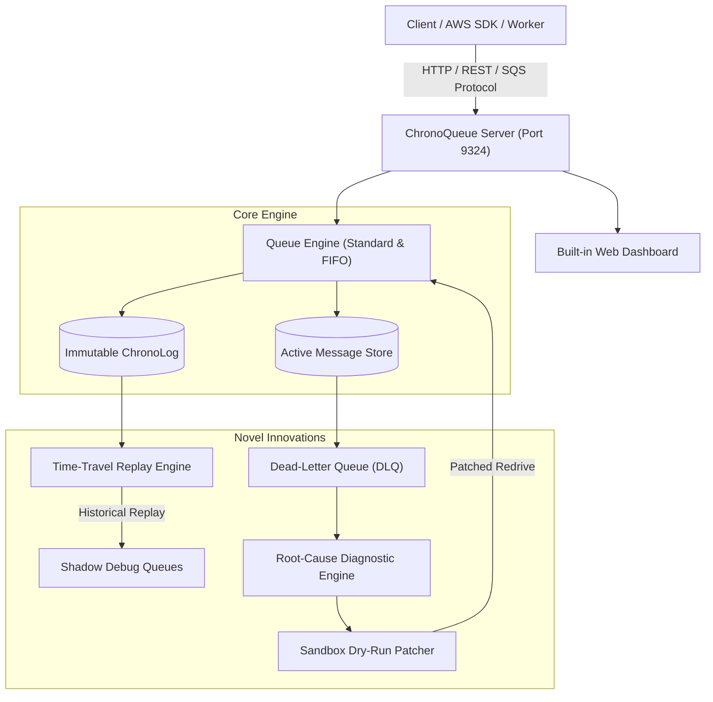

# ⚡ ChronoQueue

> **Next-Generation AWS SQS Simulator with Deterministic Time-Travel Replay & Self-Healing Dead-Letter Queue**

[](https://www.python.org/downloads/)
[](https://docs.python.org/3/)
[](https://opensource.org/licenses/MIT)

**ChronoQueue** implements a fully featured, drop-in simulator for **Amazon Simple Queue Service (SQS)**, but introduces novel capabilities that address long-standing engineering pain points in distributed systems:

1. ⏳ **Deterministic Time-Travel Replay**: In traditional SQS, consumed messages are permanently deleted. ChronoQueue maintains an immutable, append-only **ChronoLog**, allowing you to replay traffic from any historical timestamp $T_0 \to T_1$ with custom predicates into live queues or isolated shadow queues.
2. 🩺 **Self-Healing Dead-Letter Queue (DLQ)**: Instead of letting poisoned messages sit idly in a DLQ, ChronoQueue analyzes error contexts and stack traces, clusters root causes (schema drift, malformed JSON, downstream timeouts), presents dry-run diffs, and redrives patched messages in one click.
3. 🖥️ **Embedded Real-Time Web Dashboard**: A built-in dark-mode control center with live queue depth visualization, a Time-Travel scrubber, and a DLQ triage room.
4. 🪶 **Zero External Dependencies**: Pure Python 3 standard library with high-performance SQLite WAL mode persistence.

---

## 🏛️ Architecture



---

## 🚀 Quick Start

### 1. Run the Interactive End-to-End Demo
To see all features in action:
```bash
python3 demo.py
```
This runs a multi-stage walkthrough:
* FIFO deduplication verification.
* Injection of schema-drift poison pills into an active queue.
* Automatic routing to the Dead-Letter Queue upon exceeding max receive threshold.
* Automatic diagnosis of `KeyError: 'customer_id'`, dry-run preview, and patched redrive.
* Historical Time-Travel replay of past traffic into a shadow queue.

### 2. Launch the Standalone Server
```bash
python3 -m chronoqueue server --port 9324 --db chronoqueue.db
```
Open **[http://localhost:9324/](http://localhost:9324/)** in your browser to interact with the Web Dashboard.

### 3. Run the Unit Test Suite
```bash
python3 -m unittest discover -s tests -v
```

---

## 💻 Python Client SDK

ChronoQueue provides a client that supports both networked HTTP mode and embedded in-process execution:

```python
from chronoqueue.client import ChronoClient

# Connect to running server
client = ChronoClient("http://localhost:9324")

# 1. Create a Primary Queue with DLQ Target
client.create_queue("orders-dlq")
client.create_queue(
    "orders-primary",
    dead_letter_target="orders-dlq",
    max_receive_count=3
)

# 2. Publish Messages (Supports Standard & FIFO)
msg = client.send_message("orders-primary", {
    "order_id": "ORD-501",
    "customer_id": "CUST-12",
    "amount": 99.50
})

# 3. Receive & Acknowledge
messages = client.receive_messages("orders-primary", max_messages=10, visibility=30)
for m in messages:
    print("Processing:", m["body"])
    client.delete_message("orders-primary", m["receipt_handle"])
```

---

## ⏳ Feature 1: Deterministic Time-Travel Replay

When a production incident occurs or you want to replicate an edge case in staging, replay past messages without re-generating mock data:

```python
import time

now = time.time()
five_minutes_ago = now - 300

# Replay messages matching a filter into an isolated shadow queue
result = client.replay(
    source_queue="orders-primary",
    start_time=five_minutes_ago,
    end_time=now,
    filter_expr="amount>50",              # Filter by content or regex
    target_queue="orders-shadow-replay",  # Shadow queue for debugging
    dry_run=False
)

print(f"Replayed {result['replayed_count']} historical messages!")
```

---

## 🩺 Feature 2: Self-Healing DLQ & Sandbox Auto-Patch

When a microservice deploys with a breaking schema rename (e.g. `customerId` instead of `customer_id`), failed messages enter the DLQ. ChronoQueue repairs them in three steps:

### Step 1: Diagnose
```python
reports = client.diagnose_dlq("orders-dlq")
for report in reports:
    print("Issue:", report["category"])           # e.g., SCHEMA_MISSING_KEY
    print("Confidence:", report["confidence"])     # e.g., 0.95
    print("Suggested Patch:", report["suggested_patch"])
    # Suggested patch: {"rename_keys": {"customerId": "customer_id"}}
```

### Step 2: Redrive with Patch
```python
patch_recipe = reports[0]["suggested_patch"]

# Automatically transforms quarantined payloads and re-enqueues them
redrive_res = client.redrive(
    source_dlq="orders-dlq",
    target_queue="orders-primary",
    patch_recipe=patch_recipe
)

print(f"Repaired & redrove {redrive_res['successfully_redriven']} messages.")
```

---

## 🛠️ CLI Reference

ChronoQueue includes a complete CLI:

```bash
# Start server
python3 -m chronoqueue server --port 9324

# Create queue
python3 -m chronoqueue create-queue orders --dlq orders-dlq

# Send message
python3 -m chronoqueue send orders '{"event": "signup", "user": "alice"}'

# Receive messages
python3 -m chronoqueue receive orders --max 5

# Time-Travel Replay
python3 -m chronoqueue replay orders --target orders-debug --window-seconds 600 --dry-run

# Triage DLQ
python3 -m chronoqueue dlq-diagnose orders-dlq
```

---

## 📁 Project Structure

```
chronoqueue/
├── chronoqueue/
│   ├── __init__.py           # Package exports
│   ├── __main__.py           # CLI entrypoint
│   ├── models.py             # Message, QueueConfig, and Diagnostic data structures
│   ├── storage.py            # SQLite engine with immutable ChronoLog
│   ├── engine.py             # SQS semantics (FIFO, visibility, DLQ routing)
│   ├── replay.py             # Time-Travel Replay Engine
│   ├── self_healing.py       # DLQ diagnostic clustering & auto-patch sandbox
│   ├── server.py             # Multithreaded HTTP server & SQS compatibility
│   ├── client.py             # Client SDK (HTTP + Embedded modes)
│   ├── cli.py                # Command-line interface
│   └── web/
│       └── index.html        # Interactive dark-mode control dashboard
├── tests/
│   ├── test_queue.py         # Standard SQS & FIFO tests
│   ├── test_replay.py        # Time-Travel Replay tests
│   └── test_self_healing.py  # DLQ diagnosis & repair tests
├── demo.py                   # Full interactive simulation script
└── README.md                 # Project documentation
```
